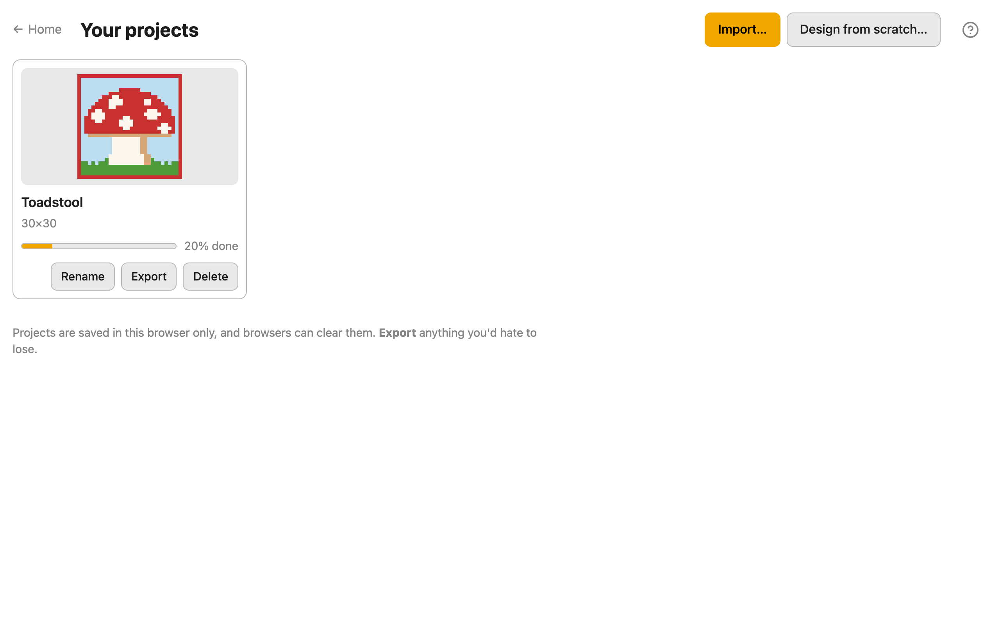

# Library

The Library, **Your projects**, holds every pattern you've imported or designed in this
browser. Open it from **Library** on the home screen, or **← Library** at the top of the
Design and Work stages. Each project shows a small picture of it, its name, its size
in stitches, and a bar for how much of it you've worked.

## In progress, Not started and Finished

Projects are listed in three groups, newest first in each. A group with nothing in it
isn't shown. Each card has one button for what you'd most often do next, and **⋯** for
the rest:

| Group | What's in it | Button | On ⋯ |
|---|---|---|---|
| **In progress** | You've worked some of it, even part of one row. | **Continue**: back to your place in the Work stage. | **Edit in Design**, **Export**, **Delete** |
| **Not started** | Nothing worked yet. | **Design**: opens it in the Design stage. | **Start working**, **Export**, **Delete** |
| **Finished** | Every row is done. | **Make again**: see below. | **Edit in Design**, **Add photo…**, **Export**, **Delete** |

## Open a project

Click or tap a project's card. It opens in the Work stage if you've worked any of it, and
otherwise where you last had it, Design or Work.

## Make a pattern again

**Make again** on a finished project makes a copy of it, named with a number ("Toadstool
(2)"), with no rows done, and opens it in the Work stage. The finished one stays in
**Finished** as it was. The copy keeps the chart, its colours and how you work it. If
you'd rather not keep it, delete it.

## Add a photo of what you made

When you've finished a project, you can keep a photo of it with the pattern: choose
**Add photo…** on **⋯** on its card, and pick the photo. It becomes the picture on the
card, so the **Finished** group shows what you've made. You can also add it from the Work
stage, with **Add a photo of what you made…** once every row is done.

To see it large, choose **Photo** on **⋯**. From there **Replace…** picks another one and
**Remove** takes it off the pattern (it asks first).

The photo is kept smaller than the original, at most 2048 pixels on its long side, and
without the details your camera adds to it, such as where it was taken. It's saved in the
pattern, so **Export** includes it; **Make again** doesn't copy it.

## Rename a project

Click or tap the project's name on its card, type the new name, then press **Save** (or
`Enter`). **Cancel** (or `Escape`) keeps the old name. You can also rename a pattern from
the Work stage's **Options**.

## Export a project

**Export**, on **⋯** on a card, saves the project as a `.alpha` file in your downloads. Export a
project to keep a copy, or to move it to another device or browser.

**Export** on a [project with pieces](#projects-with-pieces) saves one `.zip` file holding
each piece's `.alpha` file. Import the `.zip` to get the whole project back, or unzip it
to open the pieces one by one.

## Delete a project

**Delete**, on **⋯** on a card, asks first, then removes the project from this browser. It can't
be undone, so export anything you might want again before you delete it.

## Projects with pieces

Something made in parts, such as a sweater's front, back and sleeves, can be one project
in the Library, with each part a pattern of its own: a **piece**.

- **Make one:** press **⋯** on a pattern's card, then **Add to a project…**. Type a name
  for a new project, or choose one you already have, and press **Add**.
- **Its card** shows up to four of its pieces' pictures, how many pieces there are and
  their names, and one bar for the whole project. The bar counts stitches, so a small
  sleeve counts for less than a big back. The project is **In progress** once you've
  started any piece, and **Finished** when every piece is.
- **Continue** takes you to the piece you're on: the one you worked on last, or the next
  one not finished. **Open**, or a click on the card, shows its pieces.
- **Its pieces** are cards like any other, with every button they have on their own. On
  **⋯**: **Move earlier** and **Move later** change their order, and **Remove from
  project** puts one back in the Library on its own. Click a piece's name to rename it
  in the project (**Front**, **Sleeve**); the pattern keeps its own name, which shows
  beside its size.
- At the top: **Add patterns…** adds patterns that aren't in a project yet, **Yarn &
  size** adds up the yarn for every piece (a colour used in several pieces is counted
  together) and gives each piece's finished size, and **⋯** has **Rename**, **Export**
  and **Ungroup…**.
- **In the Work stage,** a piece has a list at the top for moving to another piece of the
  same project, each with how much of it is done, and **←** with the project's name takes
  you back to it. Each piece keeps its own place.
- **Ungroup…** asks first, then removes the project but keeps every piece, with its
  progress, as a pattern on its own. **Delete** on a piece deletes that pattern; a
  project whose last piece goes is removed too.

A pattern can be in one project at a time.

## What a .alpha file is

A `.alpha` file is one whole project in one file: the pattern, its colours and their
names, your progress in the Work stage, the chart image you imported, if there was
one, and the photo of what you made, if you added one. It's the only way to keep a copy of a project outside your browser.

## Back up your projects

Projects are saved in this browser only, and browsers can clear saved data, for example
after a long time without a visit or when you clear your browsing data. Export each
project you care about now and then, and keep the `.alpha` files somewhere safe, such as
a cloud drive. See [Your data](your-data.md).

## Move a project to another device or browser

1. In the Library, press **⋯** on the project's card, then **Export**.
2. Get the `.alpha` file to the other device: email it to yourself, or put it on a cloud
   drive.
3. On the other device, open the app and import the file: drop it on the home screen or
   the Library, or choose it with **Import a chart** (home screen) or
   **Import…** (Library).

Your progress comes with it. You can import several `.alpha` files at once.

## Import a project you already have

A project keeps its identity through export and import. If you import a `.alpha` file of
a project that's already in your Library, the app asks **Already in your library**,
showing how much of each copy is done. **Replace** swaps in the imported copy; **Cancel**
keeps the one you have. This stops an old backup from overwriting newer progress by
mistake.

Importing a project's `.zip` asks the same about each of its pieces that's already in
your Library, then puts the project back together around them.
